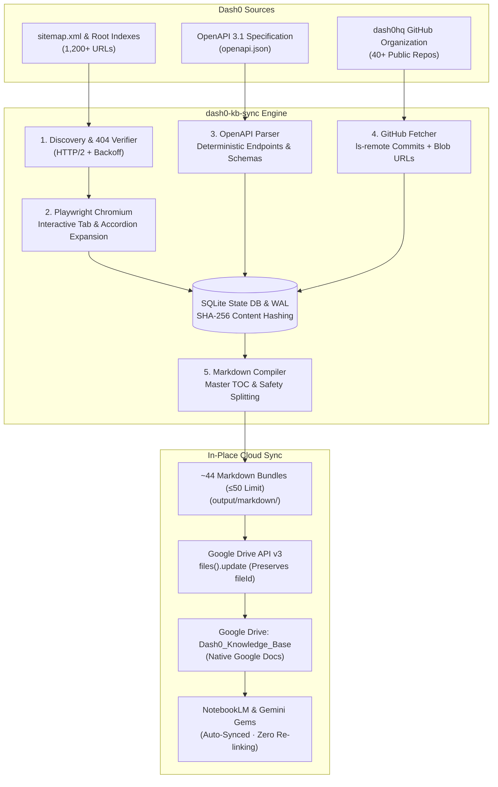

# Dash0 Knowledge Base Sync (`dash0-kb-sync`)

Automated daily knowledge-base extraction, deterministic Markdown compilation, and **in-place native Google Docs synchronization** for **Dash0** — purpose-built for **NotebookLM** and **Gemini Gems** on Apple Silicon macOS.

---

## Architecture Overview



---

## Key Features

1. **Zero Manual Re-linking in NotebookLM & Gemini Gems:**
   Uses Google Drive API v3 `files().update()` in-place. The internal Google Doc `fileId` never changes across syncs, so NotebookLM notebooks and Gemini Gems stay permanently connected without re-attaching files.
2. **Interactive Tab & Accordion Expansion (`extractor.py`):**
   Renders Next.js / React Server Component documentation with headless Playwright Chromium. It automatically clicks and expands all interactive tab groups (`[role="tablist"]`, Radix UI, custom button groups) and `<details>` accordions before HTML-to-Markdown conversion so no Kubernetes, Helm, Docker, Terraform, or OTel Collector snippets are missed.
3. **Deterministic OpenAPI 3.1 Compiler (`openapi_parser.py`):**
   Parses Dash0's OpenAPI 3.1 specification (`https://www.dash0.com/docs/api-reference/openapi.json`) into 30 structured Markdown reference sections with clean tables for endpoints, parameters, authentication schemes, and component schemas.
4. **Active GitHub Organization Tracking (`github_fetcher.py`):**
   Monitors public `dash0hq` repositories (prioritizing `dash0-operator`, `terraform-provider-dash0`, `otelbin`, SDKs, and examples). It checks remote commit SHAs via `git ls-remote`, shallow-clones updated repos, truncates changelogs to the latest 5 releases, and cites exact GitHub blob permalinks.
5. **Smart Incremental State & Timestamp-Invariant Hashing (`db.py`, `compiler.py`):**
   Persists content in SQLite with WAL mode. Content hashes normalize volatile timestamps (`Last Verified`, `Compiled At`), ensuring unchanged documents generate zero Google Drive updates.
6. **Live Sync Health & What's New Changelog (`00_Dash0_Whats_New_Changelog`):**
   Compiles a dedicated changelog document on every run with a sync health summary, 7-day and 30-day change lists, unified diff summaries for modified pages, and struck-through entries for deprecated/404 URLs.
7. **Automated Safety Splitting & Lightweight Image Links:**
   Documents are partitioned along clean page and heading boundaries with a Master Table of Contents, enforcing character, word, line, Markdown table, and fenced code-block budgets so Google Docs stay well inside Google Drive's 10 MB export ceiling and NotebookLM's ingestion timeouts (while keeping total docs under NotebookLM's 50-source limit). Embedded and reference-style images (``, `![alt][ref]`) are converted into clickable `[Image: alt](...)` text links so Google Docs stay lightweight (~350 KB instead of 15 MB of binary bitmaps).
8. **Automated macOS LaunchAgent Scheduling:**
   Includes a production-ready LaunchAgent running daily at 03:00 local time under `caffeinate -i` (full verification on Sundays, smart incremental Monday–Saturday).

---

## Target Knowledge Buckets

| # | Bucket Name | Source Prefix / Type | Description |
| :- | :--- | :--- | :--- |
| **00** | `00_Dash0_Whats_New_Changelog` | Generated / State DB | Sync health summary, 7d/30d change log, unified diffs, and deprecated 404s |
| **01** | `01_Dash0_Core_Docs` | `/docs/dash0/*` | Core product docs, installation, dashboards, query language, alerting |
| **02** | `02_Dash0_OTelBin_Docs` | `/docs/otelbin/*` | OTelBin configuration validator and visualizer documentation |
| **03** | `03_Dash0_API_Reference` | `/docs/api-reference/*` | OpenAPI 3.1 compiled endpoint references and data schemas |
| **04** | `04_Dash0_Guides` | `/guides/*` | End-to-end technical guides, architectures, and migration tutorials |
| **05** | `05_Dash0_Knowledge_Base` | `/knowledge/*` | Observability, OpenTelemetry, metrics, and tracing deep dives |
| **06** | `06_Dash0_Comparisons` | `/comparisons/*` | Observability platform and tooling comparison analyses |
| **07** | `07_Dash0_Blog` | `/blog/*` | Engineering deep dives, profiling updates, and product announcements |
| **08** | `08_Dash0_Integrations_Hub` | `/hub/integrations/*` | Integrations catalog, collector configs, PromQL checks, and dashboards |
| **09** | `09_Dash0_GitHub_Repos_and_Examples` | `github.com/dash0hq/*` | Public GitHub READMEs, Helm values, Terraform configs, and OTel examples |

---

## Prerequisites

* **Operating System:** macOS (Apple Silicon or Intel) or Linux.
* **Python:** Python 3.12+
* **Package Manager:** [`uv`](https://docs.astral.sh/uv/) (recommended) or `pip` / `venv`.
* **Google Cloud Project:** With the **Google Drive API** enabled.
* **(Optional) GitHub Token:** For higher GitHub REST API rate limits (5,000 req/hr vs 60 req/hr).

---

## Installation & Setup

### 1. Clone & Install Dependencies

```bash
git clone https://github.com/derrypete/dash0-kb-sync.git
cd dash0-kb-sync

# Create venv and install all dependencies via uv
uv sync

# Install Playwright Chromium browser binary
uv run playwright install chromium
```

### 2. Configure Google Cloud OAuth 2.0 Credentials

1. Go to the [Google Cloud Console](https://console.cloud.google.com/).
2. Create a new project (e.g., `dash0-kb-sync`) or select an existing one.
3. Enable the **Google Drive API**:
   * Navigate to **APIs & Services** $\rightarrow$ **Library** $\rightarrow$ search for **Google Drive API** $\rightarrow$ click **Enable**.
4. Configure the **OAuth Consent Screen**:
   * User Type: **External** (or **Internal** if using Google Workspace).
   * App name: `dash0-kb-sync`.
   * Add the non-sensitive scope: `https://www.googleapis.com/auth/drive.file` (grants access *only* to files created by this app).
   * **Important:** Click **Publish App** (move to *In production*). Because `drive.file` is a non-sensitive scope, no Google verification or review is required, and any Google account can log in without encountering "Test user access denied" errors.
5. Create OAuth Credentials:
   * Go to **APIs & Services** $\rightarrow$ **Credentials** $\rightarrow$ **Create Credentials** $\rightarrow$ **OAuth client ID**.
   * Application type: **Desktop app**.
   * Name: `dash0-kb-sync-desktop`.
   * Click **Create**, then click **Download JSON**.
6. Save the downloaded file as:
   ```bash
   config/credentials.json
   ```
   *(A reference template is available at `config/credentials.example.json`)*.

### 3. Authenticate with Google Drive

Run the one-time interactive OAuth login:

```bash
uv run python -m dash0_kb_sync auth
```

* A browser window will open asking you to authorize `dash0-kb-sync`.
* Upon approval, `./config/token.json` is saved securely (with `0600` permissions).
* The tool automatically creates or verifies the **`Dash0_Knowledge_Base`** folder in your Google Drive.

### 4. (Optional) Configure GitHub Token

Copy the example environment file:

```bash
cp config/.env.example config/.env
```

Edit `config/.env` and add a GitHub Personal Access Token (classic with `public_repo` or fine-grained read-only for public repositories):

```ini
GITHUB_TOKEN=ghp_your_token_here
```

---

## CLI Usage

### 1. Run the Knowledge Base Sync Pipeline

```bash
# Default: Smart incremental sync across all 10 buckets with Google Drive update
uv run python -m dash0_kb_sync run

# Force full re-scrape of every web URL and GitHub repo
uv run python -m dash0_kb_sync run --force-full

# Re-compile and upload cached data to Google Drive without re-scraping the web
uv run python -m dash0_kb_sync run --drive-only

# Local compile test: Compile Markdown files without uploading to Google Drive
uv run python -m dash0_kb_sync run --skip-drive

# Target specific buckets (by name, alias, or number)
uv run python -m dash0_kb_sync run -b 01 -b 03 -b 08

# Smoke test: Limit pages and repositories for rapid testing
uv run python -m dash0_kb_sync run --max-pages 5 --max-repos 3
```

### 2. Inspect Knowledge Base Status

Check the status of all 10 buckets, page counts, character counts, parts, and live Google Doc URLs:

```bash
uv run python -m dash0_kb_sync status
```

---

## Automated Daily Scheduling (macOS LaunchAgent)

The repository includes a GitOps LaunchAgent for macOS that keeps your knowledge base synchronized daily at **03:00 local time**.

### Install the Schedule

```bash
./install_schedule.sh
```

What this does:
* Generates `com.dash0.kb.sync.plist` dynamically configured with your user home and project path.
* Installs and activates it in `~/Library/LaunchAgents/com.dash0.kb.sync.plist`.
* Uses `/usr/bin/caffeinate -i` so the Mac does not sleep while the sync is running.
* Automatically passes `--force-full` every Sunday at 03:00, and `--incremental` Monday through Saturday.

### Uninstall the Schedule

```bash
./uninstall_schedule.sh
```

---

## Health Checks & Monitoring

### 1. How to Check for Technical Failures on Your Mac

* **CLI Status:**
  ```bash
  uv run python -m dash0_kb_sync status
  ```
  Check the `Last Run` timestamp in the header. If it's older than 24 hours, the scheduled job didn't run.

* **Application Log:**
  Inspect rotating logs in `logs/sync.log` (keeps up to 5 backups of 5MB each):
  ```bash
  tail -n 100 logs/sync.log
  ```

* **LaunchAgent Status & Exit Code:**
  ```bash
  launchctl print "gui/$(id -u)/com.dash0.kb.sync" | grep -E "state =|last exit code|runs"
  ```
  *(An exit code of `0` denotes success).*

* **LaunchAgent Output Logs:**
  * `logs/launchd.stdout.log`
  * `logs/launchd.stderr.log`

### 2. How to Track Content & URL Changes

Open **`00_Dash0_Whats_New_Changelog`** in Google Drive or NotebookLM. Every run updates:
* **Sync Health Summary:** Live table of indexed items and character counts across all buckets.
* **7-Day & 30-Day Additions:** New pages, blog posts, and GitHub repos.
* **Modified Pages & Diffs:** Exact unified diff snippets showing what technical documentation changed.
* **Removed / Deprecated URLs:** Pages removed from Dash0's sitemap returning 404 (formatted with strikethrough).

---

## Connecting to NotebookLM (Best Practices)

When creating a new notebook in [NotebookLM](https://notebooklm.google.com/):

> [!TIP]
> **Attach in Batches of 4 to 5 Files:**
> Do **not** select all 32 files simultaneously in the Google Drive picker. Because each compiled part is a dense ~80,000-word document, submitting 32 at once can exceed NotebookLM's browser UI ingestion timeout and cause `Error processing source, try again`.
>
> 1. Click **Add Source** $\rightarrow$ **Google Drive**.
> 2. Select **4 to 5 files** (e.g., `01_Dash0_Core_Docs_Part_1` through `Part_4`).
> 3. Wait ~45 seconds for processing spinners to complete.
> 4. Repeat for the remaining parts.

Once attached, Google Drive keeps the linked documents updated in the background. Subsequent 3:00 AM refreshes run server-to-server and will **not** trigger timeout errors.

---

## Project Structure

```
dash0-kb-sync/
├── config/
│   ├── credentials.example.json   # Template for Google OAuth Desktop client JSON
│   └── .env.example               # Template for optional GITHUB_TOKEN
├── scripts/
│   └── run_daily_sync.sh          # Shell wrapper executed by launchd (caffeinate + modes)
├── src/dash0_kb_sync/
│   ├── __init__.py
│   ├── __main__.py                # Package entry point (`python -m dash0_kb_sync`)
│   ├── cli.py                     # Typer CLI (`auth`, `run`, `status`)
│   ├── config.py                  # Bucket specifications, Pydantic settings, hashers
│   ├── db.py                      # SQLite StateDB, WAL mode, change event recorder
│   ├── discovery.py               # Recursive sitemap parser & root index link discovery
│   ├── extractor.py               # Playwright Chromium pool + interactive tab expander
│   ├── openapi_parser.py          # Deterministic OpenAPI 3.1 spec compiler
│   ├── github_fetcher.py          # GitHub API / git ls-remote shallow repo syncer
│   ├── changelog.py               # 00_Dash0_Whats_New_Changelog generator with diffs
│   ├── compiler.py                # Master TOC assembler & 750k-char safety splitter
│   └── gdrive_sync.py             # Google Drive API v3 in-place sync engine
├── tests/
│   └── test_pipeline.py           # Unit and Playwright integration test suite
├── com.dash0.kb.sync.plist.template # LaunchAgent template for daily 03:00 automation
├── install_schedule.sh            # Script to install & enable LaunchAgent
├── uninstall_schedule.sh          # Script to safely unload & remove LaunchAgent
├── pyproject.toml                 # Package dependencies & metadata
└── README.md
```

---

## Running Tests

Run the complete test suite (unit tests, tab expansion, OpenAPI compilation, SQLite diffs, and Drive sync error recovery):

```bash
uv run pytest -v
```

---

## License

Apache-2.0. Built for the Dash0 and OpenTelemetry community.
